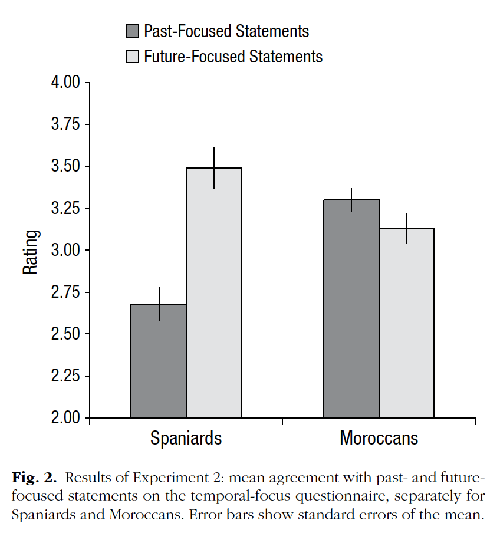

## Article

- Citation and DOI: de la Fuente, J., Santiago, J., Román, A., Dumitrache, C., & Casasanto, D. (2014).
  When you think about it, your past is in front of you: How culture shapes spatial conceptions of time.
  *Psychological Science, 25*(9), 1682–1690. https://doi.org/10.1177/0956797614534695
- Data/materials repository URL: https://osf.io/uh3in (Open Data badge)
- Part A (known case) or Part B (a classmate's project paper): Part A (Group B, Choice 3)
- Part B only: the classmate's project repo, and which target outcome is its key effect: N/A

## Target outcomes

Written **before** opening the data. Quoted from the Results section of Experiment 2 (p. 1685):

> According to a mixed analysis of variance (ANOVA) with group (Spanish vs. Moroccan) as a
> between-subjects factor and temporal focus (past vs. future) as a within-subjects factor, temporal
> focus differed significantly between Spaniards and Moroccans, as indicated by a significant
> interaction of temporal focus and group, F(1, 78) = 19.12, p = .001, ηp2 = .20 (Fig. 2). Moroccans
> showed greater agreement with past-focused statements than Spaniards did, t(78) = 4.04, p = .001,
> and Spaniards showed greater agreement with future-focused statements than Moroccans did,
> t(78) = −3.32, p = .001.

| # | Target outcome (quoted) | Paper value(s) |
|---|---|---|
| 1 | "a significant interaction of temporal focus and group" | F(1, 78) = 19.12, p = .001, ηp² = .20 |
| 2 | "Moroccans showed greater agreement with past-focused statements than Spaniards did" | t(78) = 4.04, p = .001 |
| 3 | "Spaniards showed greater agreement with future-focused statements than Moroccans did" | t(78) = −3.32, p = .001 |

Fig. 2 (cell means ± SE, read off the bar chart): Spaniards past ≈ 2.68, future ≈ 3.49;
Moroccans past ≈ 3.30, future ≈ 3.13.

## Materials inventory

| Item | Available? | Notes |
|---|---|---|
| Raw data | Yes | Item-level responses, sheet `TFQ Exp2`, in three versions of the `.xls` file: the original OSF upload (`DeLaFuenteEtAl_2014_RawData.xls`), an author-corrected version (`-OSF-corrected.xls`, after Tom Hardwicke flagged df mismatches in 2018), and a further edited version (`-OSF-corrected_EHedit.xls`). |
| Processed data | No | No participant-level means for Exp. 2 (they exist for Exp. 4 only). |
| Codebook / variable descriptions | Partial | `Notes` sheet describes the sheets; column names are self-explanatory (`group`, `participant`, `subscale`, `item`, agreement). The agreement column header says "0 = complete disagreement; 5 = complete agreement", but observed values are 1–5, consistent with the paper's "5-point" scale. Item wording is in Spanish; Table S1 is in the online supplement. |
| Analysis code | No | |
| Preregistration | No | |

## Reproduction

The agent's work, under your direction. Keep all code visible.

```{r}
#| label: setup
library(tidyverse)
library(readxl)
library(knitr)
```

```{r}
#| label: load
files <- c(
  original      = "data/DeLaFuenteEtAl_2014_RawData.xls",
  corrected     = "data/DeLaFuenteEtAl_2014_RawData-OSF-corrected.xls",
  corrected_EH  = "data/DeLaFuenteEtAl_2014_RawData-OSF-corrected_EHedit.xls"
)

read_tfq <- function(path) {
  read_excel(path, sheet = "TFQ Exp2") |>
    rename(agree = 5) |>
    mutate(group = recode(group, "young Spaniard" = "Spaniard"))
}

raw <- map(files, read_tfq)

# Notes sheet of the corrected file explains the ID problem
read_excel(files["corrected"], sheet = "Notes", col_names = FALSE) |>
  drop_na() |>
  pull(1) |>
  head(4) |>
  cat(sep = "\n")
```

The three files have identical agreement values, items and subscale labels; they differ only in the
`participant` column. In the original file, rows belonging to participants 24 and 25 were mislabelled
as participant 40 in **both** groups. The "corrected" file fixes this for Moroccans only; the
"EHedit" file fixes it for both groups.

```{r}
#| label: check-ids
# Number of items attributed to each participant ID, per file (should be 21 for everyone)
map_dfr(raw, \(d) d |> count(group, participant) |> count(n_items = n, name = "n_ids"),
        .id = "file") |>
  kable()

# Rows whose participant ID differs between files
bind_cols(
  raw$original |> select(group, subscale, item, original = participant),
  corrected    = raw$corrected$participant,
  corrected_EH = raw$corrected_EH$participant
) |>
  filter(original != corrected | original != corrected_EH) |>
  count(group, original, corrected, corrected_EH) |>
  kable()
```

Only `corrected_EH` yields 80 participants × 21 items (11 PAST, 10 FUTURE), matching the paper's
N = 80 and df = 78, so it is used as the primary data. The other two versions are run as a
sensitivity check.

```{r}
#| label: preprocess
# Per-participant mean agreement for each subscale
make_means <- function(d) {
  d |>
    group_by(group, participant, subscale) |>
    summarise(rating = mean(agree), n_items = n(), .groups = "drop") |>
    mutate(id = factor(paste(group, participant)),
           group = factor(group, levels = c("Spaniard", "Moroccan")),
           subscale = factor(subscale, levels = c("PAST", "FUTURE")))
}

means <- map(raw, make_means)
m <- means$corrected_EH

m |> count(group, subscale, n_items) |> kable()
```

### Descriptives and Figure 2

```{r}
#| label: descriptives
desc <- m |>
  group_by(group, subscale) |>
  summarise(M = mean(rating), SE = sd(rating) / sqrt(n()), n = n(), .groups = "drop")
kable(desc, digits = 3)
```

```{r}
#| label: fig2
#| fig-width: 5
#| fig-height: 4.5
ggplot(desc, aes(group, M, fill = subscale)) +
  geom_col(position = position_dodge(.9), colour = "black", width = .9) +
  geom_errorbar(aes(ymin = M - SE, ymax = M + SE), position = position_dodge(.9), width = 0) +
  scale_fill_manual(values = c(PAST = "grey55", FUTURE = "grey90"),
                    labels = c("Past-Focused Statements", "Future-Focused Statements")) +
  coord_cartesian(ylim = c(2, 4)) +
  labs(x = NULL, y = "Rating", fill = NULL) +
  theme_classic() +
  theme(legend.position = "top", legend.direction = "vertical")
```

Original Fig. 2 for comparison:

{width=60%}

```{r}
#| label: analysis
run_tests <- function(m) {
  a  <- summary(aov(rating ~ group * subscale + Error(id / subscale), data = m))
  w  <- a[["Error: id:subscale"]][[1]]
  int_row <- grep("group:subscale", rownames(w))
  res_row <- grep("Residuals", rownames(w))

  tt <- map(c(PAST = "PAST", FUTURE = "FUTURE"), \(s) {
    x <- filter(m, subscale == s)
    # Moroccan minus Spaniard, matching the sign convention in the paper
    t.test(x$rating[x$group == "Moroccan"], x$rating[x$group == "Spaniard"], var.equal = TRUE)
  })

  tibble(
    F_int   = w[int_row, "F value"],
    df1     = w[int_row, "Df"],
    df2     = w[res_row, "Df"],
    p_int   = w[int_row, "Pr(>F)"],
    pes_int = w[int_row, "Sum Sq"] / (w[int_row, "Sum Sq"] + w[res_row, "Sum Sq"]),
    t_past  = tt$PAST$statistic,   df_past = tt$PAST$parameter,   p_past = tt$PAST$p.value,
    t_fut   = tt$FUTURE$statistic, df_fut  = tt$FUTURE$parameter, p_fut  = tt$FUTURE$p.value
  )
}

# Primary analysis (fully corrected data)
primary <- run_tests(m)
kable(primary, digits = 4)
```

```{r}
#| label: aov-full
# Full ANOVA table for the primary analysis
summary(aov(rating ~ group * subscale + Error(id / subscale), data = m))
```

```{r}
#| label: comparison
paper <- c(F_int = 19.12, pes_int = .20, t_past = 4.04, t_fut = -3.32)

tibble(
  statistic  = c("Interaction F(1, 78)", "Interaction partial eta^2",
                 "PAST t(78)", "FUTURE t(78)"),
  paper      = paper,
  reproduced = unlist(primary[names(paper)])
) |>
  mutate(abs_diff = reproduced - paper,
         pct_diff = 100 * (reproduced - paper) / abs(paper)) |>
  kable(digits = 3)
```

```{r}
#| label: sensitivity
# Same analysis on all three versions of the data file
map_dfr(means, run_tests, .id = "file") |>
  select(file, F_int, df2, pes_int, t_past, df_past, t_fut, df_fut) |>
  kable(digits = 3)
```

### Summary of the reproduction (agent's claim)

Using the fully corrected file (`EHedit`), all three target outcomes reproduce in direction,
significance and approximate size, but not exactly:

- Interaction: F(1, 78) = 19.15 vs. 19.12 reported; ηp² = .197 (rounds to .20, matches).
  Actual p ≈ 3.7 × 10⁻⁵; the paper's "p = .001" appears to be a floor/rounding convention.
- PAST: t(78) = 4.00 vs. 4.04 reported (p ≈ .0001).
- FUTURE: t(78) = −3.36 vs. −3.32 reported (p ≈ .001).
- Cell means match Fig. 2 to within ~0.01–0.02.

All discrepancies are under ~1.5% of the reported value and every df matches. The original OSF file
(participant-ID error) gives the wrong df (76/77) and cannot reproduce the reported df. Welch t-tests
give the same t values with non-integer df, and item-level t-tests are far off, so neither explains
the small residual difference. A likely cause is that the authors' working file differed slightly
from any of the three posted versions (for example, a few response values or item–participant
assignments around the mislabelled participants 24/25/40). My own classification would be **minor
numerical errors** for all three outcomes, with the conclusions unaffected.

## Checker's verdict

Filled in by you, not the agent.

| # | Paper value | Reproduced value | Verdict (exact / minor / major / not reproducible) | Reason for discrepancy |
|---|---|---|---|---|
| 1 | Interaction F(1, 78) = 19.12 | 19.145 | minor | Slightly different workign data files |
| 2 | PAST t(78) = 4.04 | 4.003 | minor | Slightly different workign data files |
| 3 | FUTURE t(78) = -3.32 | -3.364 | minor | Slightly different workign data files |

Agent's own claim about success, and whether it was right:

The agent claimed it was successful in reproducing the three target outcomes in this experiment with 
minor numeric differences. The agent isn't able to explain these minor differences, citing that the
authors' working data files differed slightly from the three posted versions. This is likely true. As part of this exercise,
I had the agent iterate on many of the decisions it made/inferred, and none were able to explain the 
differences in the results.

## Time

- Your time (hours): 0.5 hours
- Agent wall-clock time (hours): 0.083 hours
- Stopped at the 4-hour cap? What remained: N/A

## Assessment

Is the primary result analytically reproducible? What would have made this take 30 minutes?

Yes, it is reproducable. This exercise took me and the agent a combined 30 minutes (there was overlap between mine and the agent's work).

## AI documentation

- Agent and interface (e.g., Claude Code, Codex CLI, Cursor): Claude Code (VS Code extension)
- Model and version, if the tool reports it: Claude Opus 5.5 (`claude-opus-5-5`)
- Context you gave it (files, instructions, any context file): `ps3/Group B/Choice 3/` (article.pdf,
  fig2.png, reproducibilityReport.Rmd, data/), `ps3_check_template.qmd`, and the instruction to
  reproduce the target outcomes and fill out a copy of the template, leaving the verdict to you.
- Number of times you intervened, and the most important intervention: 1, asking the agent to iterate on its decisions
- Transcript: link to the exported transcript in your repo (`transcripts/`). If your tool
  cannot export one, paste your prompts in order here instead.
